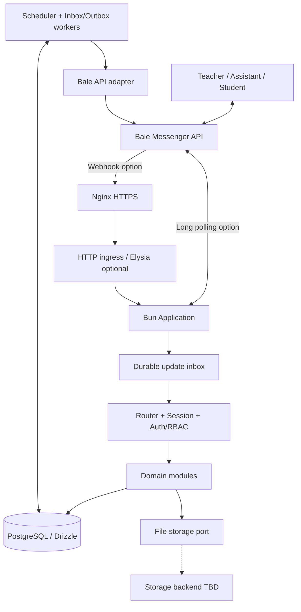

# Mashqban — Architecture & Implementation Plan

Version 1.0 — Proposed MVP architecture. Requirements: [PRD.md](PRD.md), user experience: [BOT_UX.md](BOT_UX.md), data model: [DATABASE.md](DATABASE.md).

This document is intended for the developer and Codex; it does not imply that code exists, a server is deployed, or the actual API has been tested. `AGENTS.md` takes precedence for working practices and code standards; product behavior must follow PRD.

## 1. Architecture decisions

| Topic | Status | Choice |
|---|---|---|
| Language and runtime | Agreed | TypeScript + Bun |
| Database | Agreed | PostgreSQL |
| ORM and migrations | Agreed | Drizzle ORM + Drizzle Kit |
| Packaging | Agreed | Docker + Docker Compose |
| Architecture | MVP proposal | Modular monolith, one application service and one DB |
| HTTP framework | Conditional | ElysiaJS if Webhooks or HTTP endpoints are needed; native Bun is also an option |
| Reverse proxy | Conditional | Nginx for HTTPS/Webhooks if needed |
| Update delivery | Open | Long Polling or Webhook after reviewing Bale API and server environment |
| File storage | Open — ask owner | File IDs / private server storage / hybrid |
| API client | MVP proposal | Lightweight custom fetch adapter; do not assume full Telegram compatibility |
| Queue / session / scheduler | MVP proposal | PostgreSQL, without Redis or a separate queue service |
| UI | Confirmed | Bale bot only; no web panel or public product-management API |

One teacher and 100 students do not justify microservices, Kubernetes, an event broker, or an independent cache. Verify and lock runtime/driver versions against official documentation when implementation begins; this document does not pin unverified versions.

## 2. Overview



Webhook and polling are alternatives; do not run both for one bot simultaneously. Workers may share the application process. Split processes later only when needed, with durable locks/leases.

### 2.1 Layer boundaries

- **Transport:** Receive updates and convert actual payloads into the internal model. Make no business decisions about time, classes, or identity.
- **Bot UI:** Routing, callback handling, conversation state machine, Persian text, and buttons. Invoke use cases with valid actor context.
- **Application/Domain:** Membership, invitations, RBAC, homework/versioning, feedback, reporting, transactions, and idempotency. Independent of Bale's JSON shape.
- **Persistence:** Scoped repositories, Drizzle, SQL migrations, and unit of work. Map DB errors to domain errors.
- **Infrastructure:** Bale adapter, storage, clock, workers, scheduler, logger. Network calls occur outside domain transactions.

## 3. Proposed repository structure

Adapt the structure to `AGENTS.md` while preserving modules and responsibility boundaries.

```text
mashqban/
├── docs/
│   ├── PRD.md
│   ├── BOT_UX.md
│   ├── DATABASE.md
│   └── ARCHITECTURE.md
├── src/
│   ├── index.ts                  # composition root / graceful shutdown
│   ├── config/                   # typed env validation
│   ├── bot/
│   │   ├── bale/                 # client, update parser, transport, errors
│   │   ├── router/               # command / message / callback routing
│   │   ├── sessions/             # state machine + action tokens
│   │   ├── menus/                # role-aware UI rendering
│   │   └── messages/             # Persian message templates
│   ├── modules/
│   │   ├── auth/                 # ActorContext, policy, bootstrap
│   │   ├── teachers/
│   │   ├── assistants/
│   │   ├── students/
│   │   ├── classes/              # membership history
│   │   ├── invitations/
│   │   ├── homeworks/            # draft, finalize, version, delete
│   │   ├── feedbacks/
│   │   └── reports/              # live & finalized, week/month
│   ├── database/                 # client, schema, repositories, migrations runner
│   ├── storage/                  # FileStorage port + selected adapter
│   ├── workers/                  # inbox, outbox, retries, leases
│   ├── scheduler/                # close day and catch-up
│   └── shared/                   # clock/calendar, errors, logging, ids
├── drizzle/                     # committed migrations
├── tests/                       # unit, integration, contract, e2e
├── nginx/                       # only if selected
├── .env.example
├── .gitignore
├── Dockerfile
├── compose.yaml
├── drizzle.config.ts
├── package.json
├── tsconfig.json
└── README.md
```

Use `service.ts`, `repository.ts`, `policy.ts`, and `types.ts` within modules where needed; do not create empty folders/classes merely to satisfy a pattern. Use simple dependency injection at the composition root, without circular module imports. Enable strict TypeScript, validate boundaries, use typed domain errors, and avoid unnecessary `any`.

## 4. Internal API contracts and authentication

The following names are proposed interfaces, not actual Bale endpoint names:

```ts
type ActorContext = {
  userId: string;
  baleUserId: string;
  privateChatId: string;
  teacherId: string;
  role: 'teacher' | 'assistant' | 'student';
  studentId?: string;
  assistantId?: string;
};

interface Clock {
  now(): Date;
}

interface BaleGateway {
  sendText(chatId: string, text: string, options?: unknown): Promise<DeliveryResult>;
  sendMedia(chatId: string, media: OutboundMedia): Promise<DeliveryResult>;
  answerAction?(actionId: string): Promise<void>;
}

interface FileStorage {
  prepare(input: IncomingMedia, ownerId: string): Promise<PreparedAsset>;
  resolve(assetId: string, ownerId: string): Promise<OutboundMedia>;
}
```

Define `DeliveryResult`, `IncomingMedia`, `OutboundMedia`, and `PreparedAsset` after checking the real contract. These examples are incomplete and do not compile independently. Delivery state must distinguish API acceptance, definitive failure, and unknown outcome.

### 4.1 Access control

- Build ActorContext from the actual `from.id` in a validated update and DB identity. Username/chat_id do not replace user ID. Callbacks never establish role or owner.
- Every command/query uses policies such as `canManageClass`, `canManageStudent`, `canSubmitHomework`, `canViewHomework`, `canSendFeedback`, and `canReadReport`. Role alone is insufficient: check owner, membership, active status, homework ownership, and time.
- Assistants may run queries and feedback commands, but no deletion/administration. Unknown users may only access invitations and help.
- For sensitive mutations, recheck authorization inside the transaction and coordinate identity/membership changes. Stale sessions, callbacks, and outbox records do not confer new permission.
- Never send sensitive data to groups or user-supplied chat destinations. Derive feedback destinations from internal records and current account bindings.

## 5. Bale Bot API investigation (required before a real adapter)

Inspect official Bale documentation and a test bot. Similarity to Telegram is not a substitute for contract testing. Record a short spike report in `docs/`:

| Area | Establish |
|---|---|
| Base URL / authentication | Valid path/method, error handling, secrets |
| Update transport | Webhook/Long Polling support, offset/ack, redelivery, concurrency |
| Identity | Update/user/chat ID types, private-chat detection |
| Buttons/callbacks | Keyboard structure, maximum payload, ack, message editing, callback expiry |
| Media | Actual photo/video/voice/document/audio and other types, media groups, suitable size selection |
| Storage | File IDs within the same bot, durability/resending, downloading, size limits, link lifetime |
| Outbound | Text/voice sending, text/file limits, API rates, retry errors, possible idempotency |
| Security | Webhook source authentication, TLS, request/response limits |

For every area, record at least a sanitized request/response example or test result, without tokens or real student information, plus known limitations. Do not assert API capabilities without documentation or tests.

### 5.1 Transport selection

**Long Polling:** Simpler for the MVP if the API supports it reliably, offsets are dependable, and the server has one instance. It requires no public endpoint, Nginx, or Elysia. Advance offsets only after durably saving updates, not before inbox insertion. Prevent two consumers from receiving for the same bot concurrently.

**Webhook:** If supported by the API and deployment: use TLS, a secret path, official source verification where supported, Nginx, a lightweight HTTP handler, body limits, and rate limits. A secret path alone does not replace strong authentication. Acknowledge success only after durable inbox persistence; on DB errors return the response required by Bale's retry contract. Do not upload or perform long processing inside the request handler.

Record the decision based on the spike and deployment environment. Add Elysia/Nginx only when needed.

## 6. Update processing and durability

1. A validated transport parses updates and stores them in the inbox (`processed_updates`) under `(bot_instance_key,update_id)`. Duplicate inserts have no effect.
2. Workers claim ready work with leases. For the MVP, serialize processing per user/chat and preserve conversation update order to the extent Bale's contract supports it. Different users may run concurrently.
3. The router resolves identity/session and checks callback scope/expiry. File inputs become prepared/pending assets.
4. In a short transaction, the use case writes state, business mutations, audit records, and outbox messages. Mark inbox processing complete in the same transaction as DB effects. File network operations run separately with durable state.
5. The outbox worker sends to Bale and records results/errors in the DB. Business success and message-delivery success are distinct. `/start` must recover from committed state.

Multi-file/version workflows use an operation ID independent of update ID; double-clicks and retries after crashes must not duplicate business effects. Do not retry invalid updates indefinitely. Recoverable failures use backoff and dead-letter/status records. After a crash following claim, lease expiry makes work claimable again. Handle unknown network outcomes as described in section 9.

## 7. Time, versioning, and reports

- A `calendar` module handles Tehran schoolDate, allowed windows, Saturday–Friday weeks, and Solar Hijri month boundaries. Use UTC server dates and an IANA time zone, not a manually fixed offset. Verify a reliable Bun-compatible conversion solution. Use `Intl.DateTimeFormat('fa-IR-u-ca-persian', ...)` for display if supported, and tested calculations for parsing/boundaries.
- Unit tests use an injected Clock; integration uses authoritative DB time. Make the final time decision after locking, immediately before mutation. Reject exactly 22:00. The shared day/snapshot lock includes writes accepted before 22:00 but committed shortly afterward. File/network calls occur before/after transactions, not while holding locks.
- Published versions are immutable; drafts are separate. Removing a file removes its association only in the new snapshot. Preserve earlier versions. Commit atomically with an optimistic base-version check. Reports and feedback never reference drafts.
- Reports are live before 22:00; historical snapshots afterward are proposed. Backfill reconstructs historical versions/membership at the 22:00 boundary, not today's state. PRD and DATABASE define the precise policy.

## 8. File storage design — open owner decision

**Before implementing file storage, ask the owner:** “Should homework and feedback files be stored on the server/private storage, rely on Bale File IDs, or use a hybrid?” Record the question and answer. Codex must not choose the final backend unilaterally.

| Option | Benefit | Risk/condition |
|---|---|---|
| File IDs only | Low storage and transfer requirements | Verify old-file durability/retrieval in the API; dependence on Bale and bot changes |
| Private server/object storage | Greater control over retention and backups | Disk/traffic costs, children's data protection, cleanup, recovery |
| Hybrid | Fast File ID use plus independent backup | Synchronization complexity, cost, two-source policy |

The `FileStorage` port and mock can proceed before the decision. If File IDs are unreliable long term, File-ID-only storage conflicts with version retention and must not be selected without resolving that conflict. Never put public URLs or file contents into DB sessions/logs. Define streaming downloads, size/count limits, actual-data MIME detection, safe filenames, timeouts, and malware controls for the chosen backend. Clean expired-draft files only when no valid references remain. Numeric limits are undecided.

## 9. Scheduling and message delivery (Outbox)

Use durable DB-based scheduling rather than only an in-memory cron. Proposed tick interval: 30–60 seconds; catch up immediately on startup.

```text
on startup / tick:
  determine closed Tehran school dates since teacher activation
  for each missing closed date:
    transaction:
      lock teacher and school date in canonical order
      recheck existing snapshot
      create daily report and entries as of 22:00
      enqueue report for teacher + active connected assistants
      advance durable cursor only for completed day
  dispatch due outbox rows with a bounded worker
```

- Unique owner/day report keys and recipient/message-part outbox keys prevent duplicate generation. Create reports and enqueue deliveries in one transaction.
- Send outside DB transactions with leases, timeouts, exponential backoff plus jitter, and actual API rate limits. Retry according to error type and official provider instructions.
- Send reports to the teacher and active, linked assistants. Proposed missed-day policy: use the teacher's currently active recipients at catch-up time and explicitly label the report date; exclude assistants inactive at dispatch. Catch-up batch/day limits control load, not discard reports.
- Resolve feedback recipients from the student's current binding and recheck before dispatch. Rebinding/role revocation between recheck and the network call is an external race. Reduce it using short leases and service-level coordination between rebinding and delivery, without long DB locks around network calls. Messages already accepted by the API cannot reliably be recalled.
- Definitive temporary failure → retry; definitive permanent failure → failed/cancelled. Timeout after a possible send or crash after API acceptance → `unknown`, unless the API supports idempotency or querying outcomes. For unknown outcomes without provider support, prohibit blind retries; require manual review/informed resend after confirmation. Clearly record possible loss/duplication of reports or feedback. External exactly-once delivery cannot be guaranteed without a provider contract.
- Proposed internal failed/unknown status tool for the authorized owner or deployment-operator CLI, with controlled retries. This is not a product administrator role or web panel. Assistants cannot change others' delivery status.

## 10. Environment configuration and deployment

Variable names are proposals. `.env.example` contains only placeholders and explanations; never commit real tokens.

```dotenv
NODE_ENV=development
DATABASE_URL=postgresql://mashqban:CHANGE_ME@db:5432/mashqban
BALE_BOT_TOKEN=
TEACHER_BALE_ID=
BOT_INSTANCE_KEY=mashqban-primary
BOT_TRANSPORT=polling
TZ=UTC
INVITE_CODE_SECRET=
LOG_LEVEL=info
# Only for webhook mode:
# PORT=3000
# WEBHOOK_PUBLIC_URL=
# WEBHOOK_SECRET=
# Storage env: define after owner decision
```

`BOT_TRANSPORT=polling` is only a proposed placeholder; actual activation depends on the spike. `Asia/Tehran` and 14:00/22:00 are fixed product rules, not teacher-editable settings. Validate tokens, IDs, DB connectivity, mode, and dependent configuration at startup. Redact database URLs and secrets in logs.

### 10.1 Docker Compose

- `app`: verified/pinned Bun version, dependency lockfile, reproducible build, non-root execution where possible, graceful shutdown. Expose only necessary HTTP-mode ports.
- `db`: pinned PostgreSQL, durable volume, healthcheck, internal network; no public production DB port.
- `nginx` only for Webhooks: TLS/certificate renewal, proxy necessary endpoints only, API-appropriate rate/body limits. Polling needs no public port.
- Define file/secret/backend volumes after the storage decision; do not keep persistent data in ephemeral container layers.
- Run migrations once per release before app startup with backup/rollback plans. No production `drizzle-kit push` or automatic schema resets. Commit lockfiles and migrations.
- Health/readiness through HTTP where applicable or an internal command. Readiness checks DB connectivity/schema compatibility, not repeated Bale API calls. Configure restart policy and SIGTERM handling: stop new claims, finish current transactions, release leases or recover after expiry.

## 11. Security, privacy, and operations

| Risk | Control |
|---|---|
| IDOR / forged callback | Scoped query, policy, opaque token bound to user/chat/context, expiry/recheck |
| Two-account registration | High-entropy single-use code, unique constraints, transactions, target locks |
| Invitation brute force | Account/global rate limits, generic responses, secure digests |
| Student-file leakage | Private backend, authorization on every retrieval, correct destination, no group display |
| Credential leakage | Environment/secrets, redaction, no raw tokens/invitations, rotation |
| Malicious/oversized files | API/application limits, streaming, timeouts, type validation, no file execution, pre-release scanning policy |
| Lost history | Immutable versions, soft deletion, coordinated DB/file backups, restore tests |
| Replay / races | Unique inbox, operation ID, row locks/transactions, snapshot day lock |
| Messenger failure | Bounded retries, unknown state, separate commit and message delivery |

Students are likely children. Retain only necessary data, inform staff of access/retention policy, and record owner decisions on required consent/notices, retention, deletion, and backups before release. This document does not claim compliance with a specific legal regime. Use synthetic test data.

Proposed observability: structured logs with nonsensitive correlation IDs, inbox backlog, pending/failed/unknown outbox counts, last closed day, API errors, invitation failure rates, save latency, DB/file space, and backup status. Avoid logging feedback text, files, invitation codes, and unnecessary identifiers. Use periodic encrypted backups and test restores; daily backups are an initial proposal, with RPO/RTO and retention subject to owner approval.

## 12. Implementation plan for Codex

Before changing code, read `AGENTS.md` and all four documents. Inspect the actual repository and preserve existing code unless replacement is justified. Prepare an incremental plan fitting the files and repository rules. Resolve open decisions with the owner or official evidence. Independent mocks/scaffolding may proceed; the real storage backend requires the owner's answer.

| Phase | Deliverable and completion condition |
|---|---|
| 0 — Repository review and API spike | Document Bale's contract; choose transport; ask owner about storage; record compatible Bun/Drizzle/PostgreSQL versions |
| 1 — Scaffold | Bun/strict TS, dev/test/typecheck scripts, Compose DB, sample env, logger, clock/calendar; basic boot/test |
| 2 — Database & Auth | Schema/migrations run on test DB, teacher bootstrap, invitations, RBAC, audit; AC-01..04 and AC-14 |
| 3 — Bot transport and basic UX | Mock/real adapter after spike, inbox/outbox, state machine, /start, callback scope; replay/restart |
| 4 — Management | Classes/student roster/assistants, multiple memberships, deactivation/rebinding; isolation/history |
| 5 — Homework | Storage adapter after owner decision, drafts, multiple files, versions, deletion, time boundaries; AC-05..09 and AC-15..16 |
| 6 — Feedback | Text/voice, version association, destination/delivery status; AC-10 |
| 7 — Reports | Daily, weekly, Solar Hijri monthly, snapshots, catch-up, notifications to all active assistants; AC-11..13 |
| 8 — Hardening & deployment | End-to-end tests, rate limits, privacy/retention, backup/restore, release migrations, README, operations guide |

For each phase: small reviewable changes, relevant tests, typecheck, and recorded decisions/issues. Follow `AGENTS.md` for task division and testing. Add no out-of-MVP features without an owner request.

### 12.1 Testing strategy

- Unit with `bun test`: policies, state machine, Solar Hijri/Tehran calendar, eligibility, version differences, error mapping, callbacks, invitation normalization. Do not use real time in unit tests.
- Integration on real PostgreSQL: migrations from an empty DB, composite constraints, concurrent invitations, idempotency, stale drafts, membership/account revocation, closed days, backfill after teacher deletion, outbox leases/retries.
- Contract: sanitized real Bale updates, media groups, callbacks, errors, outbound responses. Mock transport for CI and a test bot for smoke tests.
- E2E: one teacher, two assistants (one inactive), a student in two classes, two conflicting accounts, multi-file submission, editing/deletion, voice feedback, end-of-day reports. Map every numbered PRD acceptance criterion to a test or documented manual check.
- Proposed load test: 100 records and 20 concurrent flows, with mock media sizes matching future limits. Do not send uncontrolled test load to the real Bale API.
- Outage tests: stop app/DB at 22:00 and during outbox delivery; restart/catch up; prevent logical duplicate reports and record unknown outcomes.

## 13. Definition of Done

The MVP is ready for release when all PRD acceptance criteria pass or explicit owner exceptions are recorded; file types, limits, and durability on Bale/the chosen backend are tested; negative tests verify assistant/student authorization; actual daily/weekly/monthly reports and 22:00 notifications work on a test bot; migrations, backup/restore, and deployment are documented; Git contains no real secrets; retention policy is defined; and no release-critical open decision remains unresolved.

This document does not finalize Webhook/Polling, Elysia/Nginx, the file backend, exact dependency versions, file limits, or retention. Synchronize changes to proposed technical details with PRD and the other documents.
