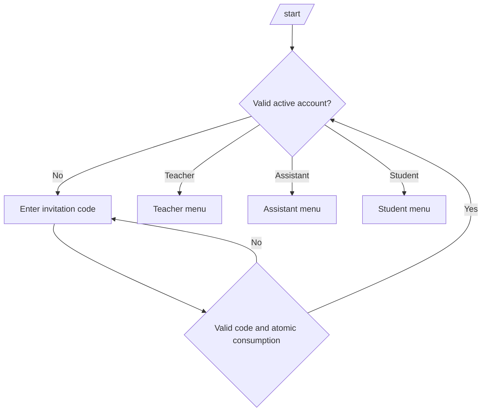
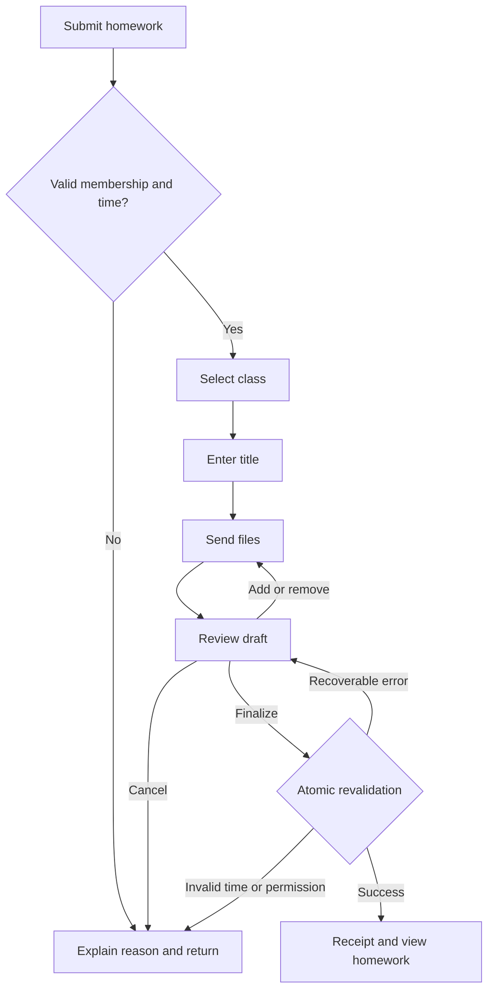

# Mashqban — Bot UX Specification

Version 1.0 — Persian-language Bale bot interface, without a web panel. Requirements: [PRD.md](PRD.md). Data model: [DATABASE.md](DATABASE.md). Processing: [ARCHITECTURE.md](ARCHITECTURE.md).

This document defines proposed MVP flows. Exact wording, pagination, and button placement may change; preserve PRD business behavior. Examples contain fictional data or placeholders. Message examples below are English translations for documentation; the deployed interface remains Persian.

## 1. General interface rules

- Use private bot chats only. Group messages must not expose student information. If a group reply is necessary, give a generic instruction to open a private chat.
- Use Persian labels, Solar Hijri dates, Tehran time in 24-hour format, and Persian display digits. Accept Persian, Arabic, and Latin digits as input; normalize invitation codes using explicit rules.
- Use interactive Bale buttons only where the actual API supports them. `/start` and `/cancel` are the baseline paths; document text-based fallbacks for missing capabilities.
- Back returns to the previous step/menu; Main menu returns to the role's home screen. Leaving a draft operation requires cancellation confirmation. Cancellation has no committed effect.
- Text, files, voice messages, or callbacks inappropriate for the current step must not create unrelated operations. Briefly explain the expected input.
- Long menus need pagination (proposed eight rows per page), name search, previous/next buttons, and empty states. Never show name lists in public messages.
- Map each action's short ID or opaque token to a server record. Verify callback capacity and message-edit support against Bale's actual API. User payloads are not an authority source.
- Bind callbacks to the user, chat, operation, teacher/class context, and version/session where needed; give them an expiry. Reauthenticate and authorize every click.
- Repeated Finalize/Delete clicks with the same operation ID produce only one effect. For expired callbacks: “This menu is outdated. Please start again from the main menu.”
- Edit the previous message when supported; otherwise send a new message and invalidate old tokens. Do not rely on guaranteed deletion of historical Bale messages.

## 2. Entry and role routing



Extensibility proposal: if an account is authorized in multiple contexts—for example, assistant to one teacher and student of another—offer role/owner selection before class selection. The single-teacher MVP generally does not need this. Store context in the session and recheck it for every operation.

### 2.1 Unknown user

> Hello! Welcome to Mashqban.
> Enter the personal invitation code you received from your teacher.

Button: “🔑 Enter invitation code.” There is no free role selection. For incorrect, consumed, revoked, or expired codes: “The invitation code is invalid or no longer usable. Contact your teacher for a new code.” Generic messages must not reveal the code owner's identity.

After successful binding: “Your membership is now active,” followed by the authorized menu. Failure to deliver the welcome message does not undo a successful DB binding; `/start` displays the correct menu again.

### 2.2 Teacher menu

```text
👋 Hello [Teacher display name]
Welcome to Mashqban.
[ 🏫 Classes ] [ 👥 Students ]
[ 🤝 Assistants ] [ 📥 Homework ]
[ 📊 Reports ]
```

### 2.3 Assistant menu

```text
👋 Hello [Assistant name]
Your access: view information and send feedback
[ 🏫 Classes ] [ 👥 Students ]
[ 📥 Homework ] [ 📊 Reports ]
```

Shared screens hide create/edit/delete/invite buttons from assistants. Assistants may send feedback; the backend enforces the same distinction.

### 2.4 Student menu

```text
👋 Hello [Student name]
Daily submission/editing window: 14:00 to 22:00 Tehran time
[ 📤 Submit homework ] [ 📝 Today's homework ]
[ 📚 Homework history ] [ 💬 Feedback ]
[ 🏫 My classes ]
```

If the student has no active classes, show instructions to contact the teacher. My classes shows only currently authorized classes.

## 3. Class management (teacher; assistants view only)

| Screen | Data | Teacher actions |
|---|---|---|
| Class list | Name, active member count, status | Create, select, search |
| Create class | Class name | Finalize, cancel |
| Class details | Name, members, today's statistics | Rename, manage members, view homework/reports, deactivate |
| Manage members | Teacher's student roster, selection state | Add/end membership, confirm |

Require a nonempty name. Proposal: reject duplicate active names under the same teacher and limit names to 80 characters. Confirm deactivation: “Deactivating this class stops new submissions from its members. Previous records will be preserved.” Staff have Active/Archived filters for historical access. Assistants are read-only.

## 4. Student management

### 4.1 Create a record and issue an invitation

```text
Students → Add student
  → First name → Last name → Select multiple authorized classes
  → Review → Confirm record creation
  → Display internal ID and invitation-code action
```

- The system generates internal IDs; users do not choose them.
- During multiple-class selection, display current selections and finish with Confirm classes. MVP proposal: allow records without classes, but prohibit submissions until active membership exists.
- To issue an invitation, the teacher selects a student and Issue invitation code. Display the personal code and expiry, if applicable, to the teacher only at issuance. Confirmed reissue revokes the old code. Do not log raw codes.

Example:

```text
✅ Student record created.
Name: Ali Ahmadi
ID: [Internal ID]
Classes: Grade 4 A, Grade 4 B
Account status: Not linked
[ 🔑 Issue invitation code ] [ Back ]
```

### 4.2 Record details

Fields: first/last name, internal ID, active classes, account status (not invited, valid invitation, linked, disconnected), and record status (active/inactive). Actions: Edit name, Manage classes, View homework, Issue/revoke invitation, Change Bale account, Deactivate. Assistants only view information, homework, and reports; they never see raw invitation codes.

### 4.3 Change Bale account

Teacher → Record → Change account → Warning → Confirm → Revoke current binding and issue a new code. Message: “The previous account will no longer have access to Mashqban. The student's homework and history will be preserved. Give the new code only to this student.”

Unbinding and creating the invitation are atomic in the DB. Invalidate the previous account's sessions/tokens in that context. Undelivered feedback must not go to the old account. If no destination account is currently linked, show staff an actionable error.

## 5. Assistant management

Teacher → Assistants → Add → Display name → Confirm → Issue single-use invitation. Details show binding status, active status, issue/revoke invitation, and deactivation. There is no business count limit. Confirmed deactivation immediately revokes access and eligibility for future notifications; previous feedback remains attributed to the historical sender.

## 6. Student homework submission



### 6.1 Steps

| Step | Input/button | Behavior |
|---|---|---|
| Select class | Authorized class | Proposed automatic selection if only one; guidance if none |
| Title | Free text | Trim; reject empty or overlong titles |
| Collect files | Photos, documents, videos, voice, other verified formats | Each valid input adds one or more files to the draft according to API behavior |
| Review | Add file, Remove file, Finalize, Cancel | Show number, name/type/size if available, count, and class |
| Confirm | Finalize | Recheck time, day, membership, at least one file, file readiness, and session |
| Finish | View homework, Submit another, Main menu | Success receipt only after commit |

Example messages:

```text
✏️ Enter the homework title.
Example: Math exercises, page 23

📎 Send the homework files.
You may send multiple files. Select Finalize when finished.

Homework draft: Math exercises, page 23
Class: Grade 4 A
1. Photo — received
2. Voice message — received
[ ➕ Add file ] [ 🗑 Remove file ]
[ ✅ Finalize ] [ Cancel ]

✅ Your homework was saved.
Date: [Solar Hijri date] | Time: [Tehran time]
Class: Grade 4 A | Files: 2
[ View homework ] [ Submit another ]
```

When file delivery involves multiple independent updates, review the draft after all processed updates. Media groups must not lose or double-count files. Test real API capabilities before finalizing the adapter. Use “File not received; please resend” only for actual failure. For files still being prepared, show “Preparing” and disable/reject finalization.

### 6.2 Closed window

Before 14:00: “Homework submission opens at 14:00 Tehran time.” From 22:00: “Today's submission and editing window has closed. You can view saved homework.”

If the deadline passes during a workflow: “The finalization deadline has passed; this draft was not saved.” For edits, add: “Your previous homework version is preserved.” A previous day's draft cannot be finalized on a new day. Issue messages claiming a successful save only after commit.

## 7. Student viewing, editing, and deletion

- Today's homework: select a class if needed, then list titles and latest save times; active homework for today only.
- Homework history: class/date selection or date pagination; only each homework's latest active version, without earlier versions or deleted homework. Proposal: preserve access to personal historical homework from former classes while the student record/account remains active; prohibit new submissions and edits in former classes.
- Details: title, class, date, time, current files, and related feedback. Show Edit/Delete only for today's homework, within the allowed window, with active membership.

### 7.1 Editing

Copy the current version into a draft; existing files need no reupload. Select a file for removal by number/short ID and confirm; add files; edit the title (MVP proposal); review and confirm.

```text
📝 Edit math homework
1. First photo
2. Second photo
3. Voice explanation
[ ➕ Add file ] [ 🗑 Remove a file ]
[ ✏️ Change title ] [ ✅ Save changes ] [ Cancel ]
```

Removing a draft file does not change the published version. If no files remain, instruct the student to add a file or delete the entire homework. For a concurrently changed base version: “This homework has changed. Open the latest version and edit it again.” Prevent silent overwrites.

### 7.2 Delete entire homework

“Are you sure you want to delete [title]? It will no longer appear in your list, but its history will remain available to your teacher.” Buttons: Yes, delete / Cancel. After commit: “Homework deleted.” If it was the day's last active homework for the class, the daily report changes to non-submitter.

## 8. Teacher and assistant homework views

Entry paths: Homework → Class → Date → Student → Homework list, or student details/daily report. Default to today. Provide All/Active/Deleted filters and name search. Date selection supports Today, Yesterday, Previous/Next day, and validated Solar Hijri `YYYY/MM/DD` input.

Example details:

```text
📚 Homework: Math exercises
👤 Ali Ahmadi | 🏫 Grade 4 A
Date: 1405/09/04
Status: Active
Latest save: 20:30 | 4 files
[ 📎 Latest-version files ]
[ 🕓 Version history ] [ 💬 Send feedback ]
[ 🗑 Delete homework ]   ← Teacher only
```

History, newest first:

```text
✅ Version 3 — 20:30 — current
   + Photo 4 added
🕓 Version 2 — 18:15 — old
   − Photo 2 removed
🕓 Version 1 — 15:00 — initial submission
```

For deleted homework: “🗑 Deleted by student/teacher at [time],” with all pre-deletion versions accessible. Version screens distinguish files removed since the previous version and files present in older versions; never mislabel removed files as current. Paginate files or send them individually to avoid flooding chats. If File IDs/storage cannot retrieve a file, show staff an error and warning; an unavailable file must not be mistaken for an intentional deletion.

## 9. Text and voice feedback

Staff → Homework/version → Send feedback → Receive text/voice → Review recipient and content → Confirm send. Proposal: explicitly show the selected old version in the review. If the current version changed after selection, keep the target version explicit and require sender confirmation.

```text
💬 Send feedback to Ali Ahmadi
Class: Grade 4 A | Homework: Math exercises | Version: 2
Send your text or voice message.
[ Cancel ]
```

Student message:

```text
💬 New feedback from [Teacher or assistant name]
Class: Grade 4 A
Homework: Math exercises
[Feedback text or voice message]
[ View homework ] [ Edit homework ]
```

Offer Edit only when permitted, and View only when an accessible current version exists. If homework is deleted, authorized feedback text/audio remains in student history without access to deleted files. Depending on the API, voice feedback may require separate explanatory and audio messages; track delivery of each part. Use precise success messages: “Feedback saved and queued” or “Feedback accepted by Bale.” Never claim it was read without a valid receipt.

## 10. Reports

### 10.1 Menu

```text
📊 Reports
[ Daily ] [ Weekly ] [ Monthly ]
[ Back ]
```

Type → Class/all classes → Period → Summary → List. Across all classes, show total class/student opportunities rather than an incorrect unique-person count. Label today's report Provisional before 22:00 and Final afterward, following the proposed PRD snapshot policy.

### 10.2 Daily report

```text
📊 Daily report — [Solar Hijri date]
🏫 Grade 4 A
👥 Eligible students: 30
✅ Submitted: 25
❌ Not submitted: 5
Participation: 83.3%
[ Submitters ] [ Non-submitters ]
[ Class homework ] [ Back ]
```

Submitters: name, active-homework count in the report, and details button. Non-submitters: name and, where available, Deleted all homework or Account not linked indicators. MVP proposal: these are staff-only context, not a third statistical category. Historical finalized counts may differ from current homework state; clearly explain the distinction on screen.

### 10.3 Weekly/monthly

Weekly: Saturday–Friday; This week / Previous week / Next week (future disabled or no data). Monthly: current/previous Solar Hijri month. Per student, show days with submissions / eligible days and days without submissions. Exclude future days from the denominator. Show today's provisional results separately from finalized totals. Provide access to daily details.

### 10.4 Automatic end-of-day message

Recipients: teacher and all active, linked assistants. Send after 22:00 Tehran time without user action. Include submission/non-submission counts per class and total opportunities. If too long, send a summary with a full-report button or multiple parts with independent delivery status, depending on API capabilities.

```text
🔒 Today's submission window has closed.
📊 Final report — [Solar Hijri date]
Grade 4 A: 25 submitted | 5 not submitted
Grade 4 B: 20 submitted | 3 not submitted
[ View full report ]
```

The button points to the report's date, not the click date. Recheck recipient authorization when clicked. Send no other individual-homework notifications to staff.

## 11. Conversation state machine (implementation proposal)

| State | Required context | Main transition |
|---|---|---|
| `IDLE` | identity, role, teacher context | select menu |
| `INVITE_INPUT` | user, chat | redeem → IDLE |
| `CLASS_CREATE` / `CLASS_EDIT` | teacher, class? | confirm → IDLE/detail |
| `STUDENT_CREATE` / `STUDENT_EDIT` | teacher, student?, fields | select classes → confirm |
| `MEMBERSHIP_EDIT` | teacher, student/class, selections | confirm |
| `ASSISTANT_CREATE` | teacher, display name | confirm |
| `HOMEWORK_CLASS` | student context | select → HOMEWORK_TITLE |
| `HOMEWORK_TITLE` | student, class, school_date | text → HOMEWORK_FILES |
| `HOMEWORK_FILES` | draft_id | file/remove/preview/finalize |
| `HOMEWORK_EDIT` | draft_id, homework_id, base_version | file/remove/title/finalize |
| `DELETE_CONFIRM` | target_id, expected state/version | confirm/cancel |
| `FEEDBACK_INPUT` | staff context, homework_id, version_id | text/voice → FEEDBACK_CONFIRM |
| `FEEDBACK_CONFIRM` | draft feedback, target context | confirm/cancel |
| `REPORT_FILTER` | teacher, class?, period | select → report view |

MVP proposal: one active session per account/chat with `revision` and operation ID. Homework drafts expire no later than 22:00 that day; other sessions default to 24 hours. Restore sessions from the DB after restart. Changing context or leaving with an open draft requires cancellation confirmation. Handle concurrent saves and stale callbacks through optimistic concurrency/locking.

## 12. Errors and expected behavior

| Condition | Proposed message | Effect |
|---|---|---|
| Outside window | “Submission or editing is not currently open.” | No save |
| No membership | “You do not have access to this class.” | Return to authorized classes |
| Staff access revoked | “Your access to this section is not active.” | No data displayed |
| Invalid invitation | “The invitation code is invalid or no longer usable.” | No binding |
| Unsupported file | “This file type cannot be received; send another file.” | Preserve the draft |
| Empty draft | “Send at least one file.” | No save |
| Conflicting version | “The homework has changed; reopen the latest version.” | No overwrite |
| DB/network failure | “The operation failed. Please try again.” | Verify definitive DB state; do not mistake unknown outcomes for successful receipts |
| Feedback delivery failure | “Feedback was saved, but delivery to Bale has not succeeded yet.” | Record status in history; controlled retry |
| No results | “There is nothing to display.” | Back button |

## 13. Preparation before implementing the UX

- Verify buttons, payload limits, message editing, voice delivery, File IDs, media groups, and text limits against the actual Bale API.
- Test PRD AC-01 through AC-16 with a fake adapter and a test bot; do not use real student information in tests.
- Review Persian examples on Bale mobile, numeric/date ordering, readability, and cancellation flows. This document is neither an executable mockup nor UI code.
