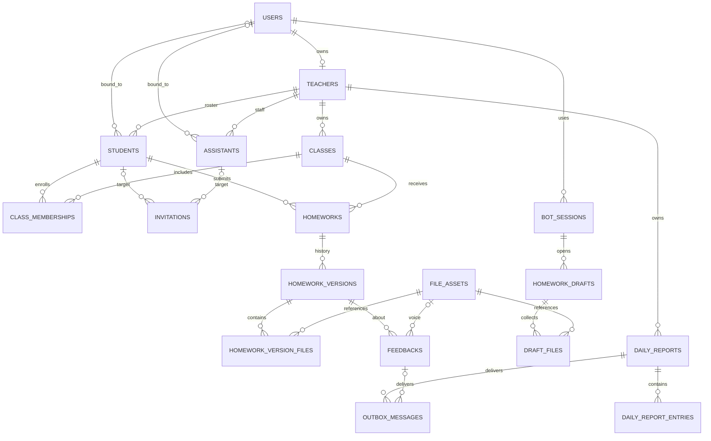

# Mashqban — Database Design

Version 1.0 — Proposed implementation design for PostgreSQL + Drizzle ORM. Product behavior reference: [PRD.md](PRD.md). This is not an executed migration or a tested schema; technical names and structures are proposals. Review the open decisions at the end before dependent implementation.

## 1. Modeling principles

- PostgreSQL is the sole source of truth for business data, sessions, and scheduling. Redis is unnecessary.
- Use `uuid` for internal primary keys and record IDs, `timestamptz` for events, and `date` for the Gregorian date corresponding to the Tehran school day. Solar Hijri conversion belongs only in the calendar/UI layer; a Solar Hijri date string is not a reporting key.
- Store `bale_user_id` and `bale_chat_id` as `bigint`; use TypeScript `bigint` or strings without precision loss. Validate types and ranges against the actual API contract. Do not blindly convert to `number`.
- Every owned record has a direct `teacher_id` or ownership provable through composite foreign keys. Teacher IDs and user IDs are distinct.
- File/homework deletion and entity deactivation must preserve history. Use `ON DELETE RESTRICT` for historical data; physical cleanup requires an approved policy.
- Maintain the Drizzle schema and versioned migrations, with explicit SQL for CHECK constraints, composite foreign keys, partial/exclusion indexes, or triggers the ORM cannot express precisely.
- The following tables form the complete proposed design. The initial 14-table discussion was preliminary, not a limit. Operational and reporting tables were added for durability and historical separation.

## 2. Logical ERD

The diagram shows only major relationships. Ownership foreign keys, acting users, audit records, and infrastructure tables are specified below. Enforce every non-nullable foreign key in the migrations.

## 3. Identity and educational structure

### `users`

| Column | Type / constraint |
|---|---|
| id | uuid PK |
| bale_user_id | bigint NOT NULL UNIQUE |
| private_chat_id | bigint NULL; populate only from a verified private chat |
| username, display_name | text NULL; display information only |
| created_at, updated_at, last_seen_at | timestamptz |

An unknown account may have a user record for invitation state, but that record alone grants no permission. Username is not an identity key.

### `teachers`

`id uuid PK`, `user_id uuid NOT NULL UNIQUE FK users`, `display_name text`, `created_at timestamptz`, `disabled_at timestamptz NULL`. Bootstrap the initial owner idempotently from environment configuration. Changing an existing owner requires a separate process. In the MVP, `user_id` must not also be a student or assistant account under that owner; enforce this in the service/transaction.

### `students`

`id uuid PK` (generated ID suitable for display), `teacher_id uuid FK teachers NOT NULL`, `user_id uuid FK users NULL`, `first_name text NOT NULL`, `last_name text NOT NULL`, `created_at`, `updated_at`, `disabled_at NULL`, `binding_revision bigint NOT NULL DEFAULT 0`.

- `UNIQUE(teacher_id,id)` supports composite foreign keys. A partial UNIQUE constraint on `(teacher_id,user_id) WHERE user_id IS NOT NULL` prevents binding one account to two records under the same teacher.
- Each record has only one current `user_id`. Account changes replace/clear the old binding; `audit_events` preserves its history. Homework references `student_id`, not `user_id`, so account changes preserve records.
- For multiple teachers, student records are owner-scoped. The same account may eventually bind to records under different teachers. Proving real-world identity is outside this model.

### `assistants`

`id uuid PK`, `teacher_id uuid FK teachers`, `user_id uuid FK users NULL`, `display_name text NOT NULL`, `created_at`, `updated_at`, `disabled_at NULL`, `binding_revision bigint DEFAULT 0`.

Use `UNIQUE(teacher_id,id)` and partial unique `(teacher_id,user_id)` for bound accounts. Check conflicting roles under the same owner using a transaction and owner lock. MVP proposal: one account has one role per owner. Deactivation revokes open invitations and invalidates sessions/pending deliveries. Historical feedback retains the recorded actor and display-name snapshot.

### `classes`

`id uuid PK`, `teacher_id uuid FK teachers NOT NULL`, `name text NOT NULL`, `created_at`, `updated_at`, `disabled_at NULL`.

Use `UNIQUE(teacher_id,id)`. Proposed partial unique `(teacher_id, normalized_name)` for active classes; implement `normalized_name` as a separate column or expression index matching normalization rules. Preserve inactive classes for staff historical views.

### `class_memberships`

`id uuid PK`, `teacher_id uuid NOT NULL`, `class_id uuid NOT NULL`, `student_id uuid NOT NULL`, `joined_at timestamptz NOT NULL`, `left_at timestamptz NULL`, `created_by_user_id uuid FK users`.

- Foreign keys: `(teacher_id,class_id)` → classes and `(teacher_id,student_id)` → students; prohibit cross-owner membership.
- `CHECK(left_at IS NULL OR left_at > joined_at)`; partial unique `(class_id,student_id) WHERE left_at IS NULL`. The interval is `[joined_at,left_at)`; reactivation creates a new row.
- Prevent overlapping intervals with a proposed exclusion constraint using `tstzrange` and `btree_gist` (verify environment support), or transactional locking per class/student pair with concurrency tests.
- Deactivating a student/class closes all relevant open memberships in the same transaction. Membership intervals are authoritative for historical reporting. Reactivation must not silently reopen old memberships.

### `invitations`

`id uuid PK`, `teacher_id uuid FK teachers`, `student_id uuid NULL`, `assistant_id uuid NULL`, `code_digest text NOT NULL UNIQUE`, `issued_by_user_id uuid FK users`, `created_at`, `expires_at`, `consumed_at NULL`, `consumed_by_user_id uuid FK users NULL`, `revoked_at NULL`, `target_binding_revision bigint NOT NULL`.

- CHECK that exactly one student/assistant target is non-NULL; use composite foreign keys to the owner. Consumed and revoked states cannot coexist. Consumption time and consuming account must be NULL or non-NULL together. Expiry must follow creation.
- At most one unconsumed, unrevoked invitation per target, enforced by separate partial unique indexes for students and assistants. Since partial-index conditions cannot depend on `now()`, reissuing revokes all previous open invitations, including expired ones.
- Use HMAC or a secure hash suitable for high-entropy random codes; keep secrets outside the DB. Never store raw codes. Consume using `SELECT ... FOR UPDATE`, checking expiry, active target, correct revision, NULL binding, and no role conflict, all in one transaction. Use a fixed lock order (owner → target → invitation), then recheck.

## 4. Homework and files

### `homeworks`

`id uuid PK`, `teacher_id uuid NOT NULL`, `class_id uuid NOT NULL`, `student_id uuid NOT NULL`, `school_date date NOT NULL`, `created_at timestamptz NOT NULL`, `current_version_id uuid NOT NULL` (by transaction end), `deleted_at timestamptz NULL`, `deleted_by_user_id uuid NULL FK users`.

Composite class/student foreign keys enforce the same owner; `UNIQUE(teacher_id,id)`. Enforce membership and timing in a transactional domain service. Store titles in versions for traceability. CHECK that deletion state and actor agree. Duplicate titles are allowed. Proposed indexes: `(teacher_id,class_id,school_date,student_id)` and partial `(class_id,school_date,student_id) WHERE deleted_at IS NULL`.

### `homework_versions`

`id uuid PK`, `homework_id uuid FK homeworks NOT NULL`, `version_no integer NOT NULL`, `kind enum('submitted','edited','deleted') NOT NULL`, `title text NOT NULL`, `created_at timestamptz NOT NULL`, `created_by_user_id uuid FK users NOT NULL`, `operation_id uuid NOT NULL UNIQUE`.

Use `UNIQUE(homework_id,version_no)`, `UNIQUE(homework_id,id)`, `CHECK(version_no >= 1)`, and a nonempty title. A composite foreign key from homeworks `(id,current_version_id)` to versions `(homework_id,id)`, preferably `DEFERRABLE INITIALLY DEFERRED`, resolves the insertion cycle. Pre-generate UUIDs. Versions are immutable. Whole-homework deletion creates a fileless `deleted` version and deletion marker on homeworks; earlier versions remain intact. At least one file for submitted/edited versions and zero for deleted versions is a transactional invariant or deferred constraint trigger, not a simple cross-table CHECK.

### `file_assets`

`id uuid PK`, `teacher_id uuid FK teachers NOT NULL`, `kind text NOT NULL`, `mime_type text NULL`, `original_name text NULL`, `size_bytes bigint NULL`, `provider_file_id text NULL`, `provider_unique_id text NULL`, `storage_key text NULL`, `storage_backend text NOT NULL`, `status enum('pending','ready','failed','purged') NOT NULL`, `created_at`, `created_by_user_id uuid FK users`, `checksum text NULL`, `metadata jsonb` (minimal).

- The owner selected private server storage on 2026-11-25. These fields define a logical contract; adjust the final schema for the private backend. Mark files ready only when valid/durable retrieval is possible. A Bale File ID is distinct from any unique ID; verify identifiers against the API.
- Object keys are private; permanent public URLs are prohibited. Assets are independent of versions so unchanged files are not duplicated across versions. Use `UNIQUE(teacher_id,id)` and owner-scoped foreign keys in consumers. No cross-owner deduplication in the MVP.
- Preserve historical asset metadata and references. After the owner-approved retention cutoff, purge private file bytes and mark the asset `purged`; keep files referenced by an unexpired draft or by a homework date within the retention period.

### `homework_version_files`

`teacher_id uuid NOT NULL`, `version_id uuid NOT NULL`, `homework_id uuid NOT NULL`, `asset_id uuid NOT NULL`, `position integer NOT NULL`, PK `(version_id,position)`; `CHECK(position >= 1)`. Composite foreign keys: `(homework_id,version_id)` → versions, `(teacher_id,homework_id)` → homeworks, and `(teacher_id,asset_id)` → assets. Each row is a file occurrence. If intentional duplicate files are allowed, calculate version differences as multisets of asset IDs. MVP proposal: each independent upload occurrence receives its own asset ID; later versions inherit that ID. Ordering is independent of file identity.

### `homework_drafts` and `draft_files`

`homework_drafts`: `id uuid PK`, `teacher_id`, `student_id`, `class_id`, `session_id uuid FK bot_sessions`, `school_date date`, `homework_id uuid NULL`, `base_version_id uuid NULL`, `title text NULL`, `status enum('open','committed','cancelled','expired')`, `operation_id uuid UNIQUE`, `created_at`, `updated_at`, `expires_at`, `committed_homework_id uuid NULL`.

Ownership foreign keys follow homeworks; `(homework_id,base_version_id)` → homework_versions. Both are NULL for creation and non-NULL for editing. Use an owner-scoped foreign key for committed_homework_id. Proposed `UNIQUE(teacher_id,id)` and a partial unique session index for open drafts. Editing must preserve the base homework's date/class/student, enforced by the service and applicable constraints.

`draft_files`: `teacher_id`, `draft_id`, `asset_id`, `position integer`, PK `(draft_id,position)`; composite ownership foreign keys. Removing a draft file does not alter the published version. Pending files block commit. Expired-draft cleanup marks only files without any valid reference as eligible for authorized cleanup.

### Save/edit/delete algorithm (transaction)

1. Validate identity, owner, class, and active membership; coordinate concurrent permission changes with owner/target locks.
2. Lock the day `(teacher_id,school_date)` and homework/draft in a fixed order, then reread state. If a finalized daily report exists, student changes are prohibited. For creation/editing, check the authoritative DB/clock time after locking and immediately before the business write. Do not use `now()`, which reflects the start of a potentially long transaction, for the final gate. Inject the clock in tests.
3. Check date, `[14,22)` deadline, ready files, minimum file count, open draft, and `base_version_id == current_version_id` for edits. If operation_id was already committed, return the previous result after authorization.
4. Insert the new version, file rows, and current pointer. For deletion, record the deleted version and time/actor. Close the draft and write audit and receipt outbox records in the same transaction. Teacher deletion after 22:00 is allowed but leaves the existing report snapshot intact.
5. Commit; call Bale outside the transaction. Apply the time gate at the final DB decision after locking; keep transactions short. If accepted just before 22:00 and committed shortly afterward, reporting waits on the same lock and includes it. This is the proposed technical definition of the race boundary.

## 5. Feedback

### `feedbacks`

`id uuid PK`, `teacher_id uuid NOT NULL`, `homework_id uuid NOT NULL`, `version_id uuid NOT NULL`, `author_user_id uuid FK users`, `author_role enum('teacher','assistant')`, `author_display_name text`, `kind enum('text','voice')`, `body text NULL`, `voice_asset_id uuid NULL`, `created_at`, `operation_id uuid UNIQUE`.

Composite foreign keys connect owner to homework, version to homework, and asset to owner. CHECK that nonempty body exists only for text and a non-NULL asset only for voice. Derive the recipient from the homework's student; never accept user-supplied `chat_id` as the destination. Target versions are immutable; sender names are snapshots. Derive delivery status from outbox. Commit feedback and outbox atomically. At dispatch, check the recipient's current active account and binding revision. Feedback recorded before rebinding must not go to the previous account; unknown outcomes require manual review.

## 6. Reports

### `daily_reports`

`id uuid PK`, `teacher_id uuid FK teachers`, `school_date date`, `closed_at timestamptz`, `created_at timestamptz`, `policy_version text`, `class_summaries jsonb` (proposed list of classes with historical names, including empty classes), `UNIQUE(teacher_id,school_date)`, `UNIQUE(teacher_id,id)`.

Create records only after 22:00; compute the current report live. Create report and entries in one transaction with the day lock shared with saves/deletions/membership changes. `closed_at` is that day's logical 22:00 boundary; `created_at` is actual generation time. Backfill reconstructs state as of the boundary, not current state.

### `daily_report_entries`

`teacher_id`, `report_id`, `class_id`, `student_id`, `student_name_snapshot text`, `class_name_snapshot text`, `submitted boolean`, `active_homework_count integer`, `had_deleted_homework boolean`, `account_connected_snapshot boolean NULL`, PK `(report_id,class_id,student_id)`; composite foreign keys to report/class/student; `CHECK(active_homework_count >= 0 AND submitted = (active_homework_count > 0))`.

Store minimal snapshot data. Historical names and binding state must be reconstructible from audit during backfill. If not, label the current name and use NULL for binding state rather than claiming invented history. Entries contain only eligible opportunities; non-submission is `submitted=false`. Classes archived afterward remain in that day's report.

### Calculation and historical reconstruction

- `window_start = local date 14:00 Asia/Tehran`, `window_end = local date 22:00 Asia/Tehran`; compare in UTC.
- Closed-day eligibility: `joined_at < window_end AND (left_at IS NULL OR left_at > window_start)`, plus students with valid homework that day; DISTINCT class/student pairs. Before 22:00 today, provisional eligibility uses current active membership or overlap through report time and valid homework. Future days have no entries. Before 14:00, show the current active roster provisionally.
- Valid homework at the historical boundary uses the latest version with `created_at < window_end` and `kind != 'deleted'` for that day. Teacher deletion after 22:00 does not alter the snapshot. Obtain operation timestamps from the authoritative clock after locking and before insertion. Reconstruct membership from intervals and names/status from audit. Include classes with eligible memberships or activity during part of the window (using activation history); empty classes can appear.
- If a past day lacks a snapshot, reconstruct it idempotently before displaying/sending a final report. Never fabricate missed submissions for days before owner creation/bootstrap. Show backfill failure as an error, not a false zero report.
- Weekly: Saturday–Friday. Monthly: actual Solar Hijri boundaries using valid conversion. Aggregate `SUM(submitted::int)` and `COUNT(*)` by class/student. Show today's provisional data separately. Snapshots govern closed days. Cross-class totals count opportunities, not unique people.

## 7. Durable infrastructure

| Table | Key columns / purpose |
|---|---|
| `bot_sessions` | `id`, `user_id`, `chat_id`, `teacher_id NULL`, `role NULL`, `state`, `context jsonb`, `revision`, `expires_at`, `updated_at`; UNIQUE(user_id,chat_id). Versioned context validation; no raw files/invitation codes. |
| `callback_actions` | `token_digest` UNIQUE, `user_id`, `chat_id`, `teacher_id NULL`, `action`, `payload jsonb`, `expected_revision NULL`, `expires_at`, `consumed_at NULL`; scope and replay control. |
| `processed_updates` | `bot_instance_key`, `update_id` (API-defined type), `status`, `received_at`, `processed_at`, `attempts`, `lease_until`, `last_error`, `payload jsonb NULL`; composite PK; durable inbox, bounded payload and separate retention. |
| `outbox_messages` | `id`, `teacher_id NULL`, `daily_report_id NULL`, `feedback_id NULL`, `recipient_user_id NULL`, `target_student_id NULL`, `kind`, `idempotency_key UNIQUE`, `payload jsonb`, `status`, `attempt_count`, `next_attempt_at`, `lease_until`, `sent_at`, `provider_message_id NULL`, `last_error_code NULL`, `created_at`; fixed report recipient with role recheck; resolve feedback recipient logically from student. |
| `audit_events` | `id`, `teacher_id NULL`, `actor_user_id NULL`, `event_type`, `entity_type`, `entity_id`, `occurred_at`, `metadata jsonb`; append-only before/after membership, class, identity, name, and deletion changes; no tokens, raw codes, or unnecessary content. |
| `scheduler_state` | `job_name` PK, `last_completed_school_date NULL`, `updated_at`; durable catch-up cursor; verify completion using unique daily reports; track outbox recipients separately. |

Proposed outbox states: `pending/processing/sent/retry/failed/unknown/cancelled`; index `(status,next_attempt_at)`; leases and `FOR UPDATE SKIP LOCKED` for claiming. Network sends happen outside transactions; record outcomes in short transactions. Use separate keys per message part: report `daily:<teacher>:<date>:<user>:<part>`, feedback `feedback:<id>:<part>`, receipt `receipt:<operation>:<part>`. Unique keys prevent duplicate generation, not guarantee exactly-once network delivery.

## 8. Indexes, authorization, and maintenance

- `class_memberships(class_id,joined_at,left_at)` and `(student_id,joined_at,left_at)`; `homework_versions(homework_id,version_no DESC)`; `feedbacks(homework_id,created_at)`; `daily_reports(teacher_id,school_date)`; `daily_report_entries(report_id,submitted,class_id)` and `(teacher_id,class_id,student_id)`; `audit_events(teacher_id,entity_type,entity_id,occurred_at)`; `processed_updates(status,lease_until)`; `bot_sessions(expires_at)`.
- Scoped queries use authenticated teacher context. Composite foreign keys prevent inconsistent data but do not themselves prevent unauthorized reads. RLS is optional for the MVP; if used, test pool/transaction context for leaks.
- A day advisory lock may hash the owner/date pair stably; collisions must cause only extra serialization, never incorrect access. Fixed lock order: owner/identity and membership → day (sorted for multiple days/classes) → homework/draft → outbox. Report workers use compatible ordering. Owner-row locks for MVP business mutations are simple and acceptable.
- Before final migrations, identify DB and service invariants. Simple CHECK constraints cannot enforce cross-table conditions or changing clocks; use transactions, foreign keys, and triggers appropriately.
- Coordinate DB/file backups. Use separate migration and runtime accounts; no automatic production DROP/reset. Clean sessions/tokens/raw messages using proposed TTLs and final policy; retain snapshots/versions/assets according to the owner's decision.

## 9. Migration and testing plan

Order: identity and tenant → classes/memberships/invitations → assets and sessions → homework, versions, and drafts → feedback → reports → inbox/outbox/audit/scheduler. Add the cyclic homework/version foreign key after creating both tables. Record enums and required extensions. Keep Drizzle schema and SQL migrations in Git.

Integration tests on real PostgreSQL: invitation/finalization races, membership revocation during save, cross-owner foreign keys, rebinding with preserved data, 22:00/snapshot races, stale base versions, deleting the last homework, reconstructing an old day after teacher deletion, Solar Hijri month/leap-year boundaries, unique outbox, and crash recovery. Use synthetic data. Map PRD AC-01..16 to executable tests.

## 10. Open issues

Private server storage is selected. The backend purges private bytes after one year following 31 Shahrivar of the relevant school year and retains historical metadata. The migration set was applied to a synthetic local PostgreSQL instance; the actual Bale API and backup/restore workflow remain unverified. The current per-file cap is 20 MB and per-homework cap is 20 files; actual-data MIME checks and malware controls remain deployment decisions.
